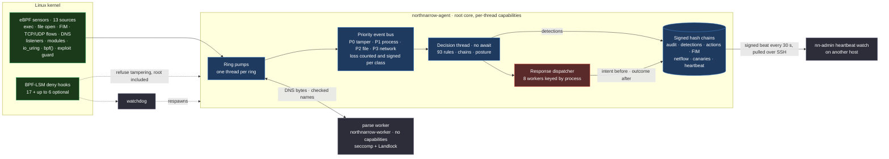

<div align="center">


# NorthNarrow

**Sovereign endpoint defence for Linux.**<br/>
Rust end to end · enforced in the kernel with eBPF and BPF-LSM · deterministic on the host · verified in a lab you can rerun.

[](https://github.com/northnarrow/northnarrow-new/actions/workflows/ci.yml)
[](https://github.com/northnarrow/northnarrow-new/actions/workflows/lab-vm.yml?query=event%3Aschedule)
[](https://github.com/northnarrow/northnarrow-new/releases)
[](LICENSE)
[](Cargo.toml)
[](docs/operator/KERNEL_COMPATIBILITY.md)

[Why](#why-northnarrow) ·
[Architecture](#architecture) ·
[Defence in depth](#defence-in-depth) ·
[Verified today](#verified-today) ·
[Limits](#limits-said-plainly) ·
[Quickstart](#quickstart) ·
[Roadmap](#roadmap) ·
[Supply chain](#security-and-supply-chain) ·
[Contact](#work-with-us)

</div>

> [!IMPORTANT]
> **Pre-Beta.** A single-founder project, built in the EU. Linux x86_64 only. No release with
> assets has been published yet: build from source. Nothing here has been validated by a third
> party. Every number below points to the file or the CI run it comes from, and
> [Limits, said plainly](#limits-said-plainly) lists what is still open.

---

## Why NorthNarrow

Most endpoint products are a sensor that streams your telemetry to someone else's cloud, where
a model you cannot inspect decides and an operator you do not employ reacts later. For a
European bank, hospital, utility or public body under NIS2 and DORA, that architecture is a
liability before it is a product. NorthNarrow inverts it:

| | Cloud-first EDR/XDR | **NorthNarrow** |
|---|---|---|
| Where telemetry goes | the vendor's cloud | **stays on the host**: the agent's only traffic of its own is a DNS probe to `127.0.0.1:53` |
| Who decides | remote models and a SOC | **deterministic rules**, correlation and an adaptive posture, on the host; no AI model on the host |
| Who responds | a human, later | **the host itself**, on a graduated ladder that only a signed human command releases |
| Can root switch it off? | varies | **hardened against root**: BPF-LSM refuses signals, ptrace, file tampering, cgroup kills, freezes, moves and resource limits, root included, outside a signed maintenance window. Not absolute: see [the limits](#limits-said-plainly) |
| Air-gapped hosts | degraded | **first-class**: no update channel, offline attestation |
| Trust | "trust us" | **signed hash chains**, a signed heartbeat verified off the host, open code, a lab and a CI gate anyone can rerun |

---

## Architecture



| | |
|---|---|
| **Sense** | Thirteen sources on tracepoints, kprobes, uprobes, fentry/fexit and BPF-LSM hooks. Each source's attach point, fallbacks, failure mode, budgets, truncations and loss counters are a contract in code, and the agent signs a capability manifest of what really attached, at boot and at every change ([sensor contract](docs/operator/SENSOR_CONTRACT.md)). |
| **Prioritise** | Every event class has its own queue. Tamper (P0) is taken first, so a flood of file opens no longer pushes denials out. A full queue follows its class's policy, and every drop is counted and signed, never silent ([event bus](docs/architecture/EVENT_BUS.md)). |
| **Decide** | One OS thread with no `await` judges every event against 93 rules, chain correlation and the posture; most of the blocking I/O it used to do now runs elsewhere. There is no AI model on the host: the on-host LLM advisor was removed in Wave 4 ([upgrade notes](docs/operator/UPGRADE_NOTES_WAVE4.md)). |
| **Act** | Responses go to a dispatcher: eight workers by default, Critical first, one process's responses in order. Each action is a signed intent before it runs and a signed outcome after it. The posture rises from OBSERVING through ALERTED and ENGAGED to COMBAT only on corroborated evidence. COMBAT climbs from INVESTIGATE to NEUTRALIZE to ISOLATE, and only an Ed25519-signed command releases it. |
| **Isolate** | Hostile bytes (DNS names today) are parsed by an unprivileged worker: the `northnarrow-worker` account, no capabilities, a seccomp allowlist and Landlock. A source test checks that the root core calls no parser. Each core thread keeps only the capabilities its role needs. The keys live in one `KeyStore`, locked in memory and kept out of core dumps, and the signing key is decided once at boot ([process model](docs/architecture/PROCESS_MODEL.md)). |
| **Hold** | BPF-LSM deny hooks protect the agent, the watchdog and their files, maps, links and cgroups from root outside a signed trusted-installer window ([trust model](docs/design/ANTITAMPER_TRUST_MODEL.md)). A watchdog respawns the agent, and ten inert decoy files that look like kill switches trip a Critical rule when someone tampers with one. |
| **Prove** | Every admin operation, posture change, detection and action lands in a signed, hash-chained log with numbered rows and anchored heads (`nn-admin chain verify`). Every 30 s a signed heartbeat carries the loss counters, the chain heads and the manifest's hash to a verifier on another host ([heartbeat](docs/operator/HEARTBEAT.md)). |

<details>
<summary><b>The workspace: the crates of the Wave 4 restructure</b></summary>

| Crate | Holds |
|---|---|
| `nn-model` | the vocabulary: events, verdicts, actions and outcomes, process keys, posture kinds |
| `nn-proto` | the admin protocol, signed payloads, quorum, the core/worker IPC |
| `nn-evidence` | signed chains behind a `Signer` trait: canonical form, row numbers, heads, verification; no key |
| `nn-parse` | parsers of hostile bytes (DNS records and names, TLS ClientHello); fuzzed, run in the worker |
| `nn-core` | detection, posture, correlation, COMBAT and response policy, the sensor contract, the bus types; no OS call |
| `nn-linux` | the adapters: eBPF loader and sensors, `/proc`, actuators, self-defence, systemd, `KeyStore`, sandbox |
| `nn-admin` | the operator client |
| `northnarrow-agent` | the composition: typed boot phases, bus and pipeline, admin server, worker supervisor |

`nn-model`, `nn-proto`, `nn-evidence`, `nn-parse` and `nn-core` are pure: no OS interface, no
`unsafe`, and CI builds them for non-Linux targets. The allowed dependencies between crates are
in [`docs/architecture/module-map.toml`](docs/architecture/module-map.toml), and
`xtask/tests/workspace_layers.rs` enforces them.

</details>

---

## Defence in depth

What a root shell can try against the agent **outside a signed maintenance window**, what stops
it, and what it leaves behind. Inside a window (`nn-admin trusted-installer-grant`, an admin key
with the trusted-installer role) upgrades, uninstalls and restarts work as usual.

| Attack | Defence | Evidence left |
|---|---|---|
| `kill -9`, or any signal to the agent or the watchdog | `task_kill` refuses every userspace signal but signal 0, a self-signal and agent ↔ watchdog | signed denial, `NN-L-AT-001`, posture escalation |
| `ptrace`, `/proc/<agent>/mem` | `ptrace_access_check` refuses | signed denial, `NN-L-AT-001` |
| Delete, rename, rewrite or `chmod` the binaries, units, keys or chains; add a drop-in or an overlay | `inode_*`, `file_open` and `file_permission` deny hooks; no new entries in the agent's directories | signed `unlink`, `rename`, `setattr`, `write`, `create` |
| `systemctl kill -s SIGKILL` (`cgroup.kill`), `systemctl freeze`, a move out of the unit's cgroup | the units' cgroups protected; the move guard, self-tested at every boot (lot 273) | signed `cgroup_kill`, `cgroup_freeze`, `cgroup_move` |
| A low `memory.max` (an OOM kill), `cpu.max` or `pids.max` starvation, `systemctl set-property`, a cgroup v1 `freezer`, `oom_score_adj` | refused, except PID 1 writing back a file's registered value; cgroup v1 where systemd runs the unified hierarchy (lot 273b) | signed `cgroup_limit`, `cgroup_v1`, `oom_adj`; PID 1's attempts as `RelayedTamperAttempt` |
| Rewrite the agent's BPF maps, detach or replace its links | `bpf_map` and `bpf` hooks refuse write handles and link detach/update | signed `bpf_map` / `bpf_link` denial, `NN-L-BPF-002` |
| `kexec` into a kernel without the agent | the running agent refuses kexec image loads; `kernel.kexec_load_disabled=1` covers the time before it starts | signed denial, `NN-L-AT-001` |
| Freeze, starve or blind the agent some other way | the watchdog respawns it; the external verifier alerts | `SILENT`, `STOPPED`, `DEGRADED`, `REPLAY` or `TAMPERED` off the host |
| Load a kernel module or a foreign BPF program | **recorded, not refused** by the agent: unsigned modules need kernel lockdown or module signing; refusing foreign BPF loads is planned (Phase 3) | `R018_KernelModuleLoad`, `NN-L-BPF-001` |
| `prlimit` (`RLIMIT_CPU`), scheduler or nice starvation | **not refused yet**: lot 273c, in progress | `agent_stalled` drift, heartbeat `DEGRADED` / `SILENT` |

The test lab replays these attacks: `deploy/lab/nn-lab.sh tamper-check` runs each case with its
expected outcome and the evidence it must leave in the signed logs.

---

## Verified today

Measured on the code now on `main`, in our own lab and on GitHub-hosted KVM runners. These are our
own measurements, not a third party's.

| Area | Today | Source |
|---|---|---|
| Rules | **93** rules the agent can record: 85 in the engine, 8 issued outside it (anti-tamper, exploit guard, exec policy and its environment checks, exec quarantine). Strongest test per rule: an end-to-end test or a lab script for 30, unit tests only for 58, none yet for 5 (the experimental exec-policy and quarantine records) | [`RULE_CATALOGUE.md`](docs/detection/RULE_CATALOGUE.md) |
| ATT&CK mapping | 93 of 93 rules mapped to 66 techniques and sub-techniques under 12 of 15 Enterprise tactics (ATT&CK 20.0, pinned). This is a mapping, not a coverage claim: **0 rules have campaign proof** | [`ATTACK_COVERAGE.md`](docs/detection/ATTACK_COVERAGE.md) |
| Kernel enforcement | **17** BPF-LSM deny hooks on every supported kernel, plus up to 6 optional deny programs (the ACL hooks, `file_ioctl_compat`, the cgroup move guard): **23** on 6.8, 6.12 and 7.0, 21 on 5.15 and 6.1 (the ACL hooks start in 6.2); the verifier accepted 81 of 81 programs on 6.8, 6.12 and 7.0 | [`CAPABILITY_PROGRAM.md`](docs/roadmap/CAPABILITY_PROGRAM.md), C23 |
| Host tests | **3,619** passed, 0 failed, 17 ignored, in 84 suites (`cargo test --workspace`) | [`ci.yml`](.github/workflows/ci.yml) |
| Privileged suites | run as root in 5 KVM guests every night. The nightly on `main` was green on 6 of 12 nights from 22 Oct to 2 Nov, and red again on 3 Nov on Ubuntu 26.04 only; every red night was traced to a lab-harness race or a test fixture, both fixed in #487. The five-guest dispatch of the gate on that fix: 87 suites and 103 tests on each guest, 0 failed ([run 41590801439](https://github.com/northnarrow/northnarrow-new/actions/runs/41590801439)) | [`lab-vm.yml`](.github/workflows/lab-vm.yml) |
| Anti-tamper lab | 104 adversarial cases, 100 as expected on Ubuntu 24.04. The other four are named: two known gaps (an unsigned module without lockdown, a vacuum of the agent's journal), one recorded deviation and one case not run | [`anti-tamper.sh`](deploy/lab/adversarial/anti-tamper.sh) |
| Event bus | in the lab's file-open flood (EXP-13), anti-tamper denials lost: 3,699 before the priority bus, **0** after | [`EVENT_BUS.md`](docs/architecture/EVENT_BUS.md) |
| Response | 400 kill trees at once: the longest queue wait went from 19 s to **1.6 s** | [`EVENT_BUS.md`](docs/architecture/EVENT_BUS.md) §2e |
| Heartbeat | the off-host verifier flagged a stopped agent in 6.5 s, a replayed export in 5.0 s, a frozen agent in 55.7 s and a cut network in 66.7 s | [`HEARTBEAT.md`](docs/operator/HEARTBEAT.md) |
| Determinism | 29 golden replay cases checked byte for byte on every `cargo test`; 14 fuzz targets; 11 Kani proofs | [`GOLDEN_REPLAY.md`](docs/validation/GOLDEN_REPLAY.md) |
| Cost | open-heavy work pays: the `open` microbenchmark is +41 % with the agent on, `git status` +24 % from the cgroup move guard; the one committed baseline is from Ubuntu 24.04 | [`PERF_BASELINE.md`](docs/validation/PERF_BASELINE.md) |
| Lifecycle | fresh install, in-place upgrade with rollback, clean uninstall (`upgrade-check`, `uninstall-check`); `.deb` / `.rpm` by `pkg-check` | [operator guide](docs/operator/INSTALL_UPGRADE_UNINSTALL.md) |

### Kernels

One binary for every kernel: struct offsets come from the live BTF at boot and tracepoint
layouts from tracefs. `northnarrow-agent --btf-check <btf>` gives an offline verdict for any
kernel, and a weekly CI job recomputes the matrix over BTFHub.

| Distribution | Kernel | systemd | Status | Nightly gate | Deny hooks |
|---|---|---|---|---|---|
| Ubuntu 22.04 LTS | 5.15 | 249 | supported, degraded (DNS names through the `ITER_IOVEC` path only) | every night and on PRs | 21 |
| Debian 12 | 6.1 | 252 | supported | every night | 21 |
| Ubuntu 24.04 LTS | 6.8 | 255 | supported | every night and on PRs | 23 |
| Debian 13 | 6.12 | 257 | verified in the lab | every night | 23 |
| Ubuntu 26.04 LTS | 7.0 | 259 | verified in the lab | every night | 23 |
| AlmaLinux 9 | 5.14 (el9) | — | supported with SELinux enforcing; **not re-verified since Wave 4** | self-hosted lab only | not measured since |

The full matrix, with its prerequisites, is in
[`KERNEL_COMPATIBILITY.md`](docs/operator/KERNEL_COMPATIBILITY.md). Without the `bpf` LSM in the
active list the agent refuses to start, unless an operator opts into degraded mode (trust level
L0, no enforcement).

### Capability levels

Thirty capabilities, each with a level that changes only together with its evidence:
**0** absent, **1** partial, **2** present and tested in the lab, **3** mature and verified on every
supported kernel. The table in
[`CAPABILITY_PROGRAM.md`](docs/roadmap/CAPABILITY_PROGRAM.md) was re-assessed on 2026-11-03
against `main`, separately from the lab PRs. It is a self-assessment, not a third party's.
**No capability is at level 3.** Ten are at 2, ten at 1 and ten at 0.

<details>
<summary><b>All thirty levels</b></summary>

| Level | Capabilities |
|---|---|
| **2** | C01 Linux sensor · C06 file telemetry and FIM · C12 synchronous inline blocking (experimental, off by default) · C14 behavioural detection and correlation · C16 structured ATT&CK mapping · C17 response on processes and files · C23 anti-tamper and self-defence (*provisional*) · C24 offline and air-gapped operation · C25 data sovereignty · C26 open code and inspectability |
| **1** | C05 process telemetry (exec only) · C07 endpoint network telemetry · C11 containers · C13 malware prevention · C15 custom rules · C18 host network isolation · C19 rollback · C20 automation · C27 product supply chain · C28 safe content release |
| **0** | C02 Windows · C03 macOS · C04 ARM64 · C08 identity / ITDR · C09 cloud · C10 NDR · C21 SIEM export · C22 backend · C29 independent public validation · C30 generative AI on the host (absent by design) |

</details>

<details>
<summary><b>External security audit and internal review</b></summary>

An external audit of commit `16f7563` reported 444 findings (6 Critical, 70 High, 159 Medium,
188 Low, 21 Informational). Every Critical, High and Medium finding is closed. Of the 209 Low and
Informational findings, 189 are fixed, 6 are obsolete and 10 are declined with a stated reason;
4 are still open (3 of them partly fixed), among them the adversarial campaign run. Each fix
starts from a regression test that fails without it. The status of each finding is in
[`docs/audit/EXTERNAL_AUDIT_16f7563.md`](docs/audit/EXTERNAL_AUDIT_16f7563.md), and what the
fixes change for an operator is in
[`docs/operator/UPGRADE_NOTES_AUDIT_16f7563.md`](docs/operator/UPGRADE_NOTES_AUDIT_16f7563.md).
The internal review log [`docs/audit/NN_REVIEW_2026-10-08.md`](docs/audit/NN_REVIEW_2026-10-08.md)
has 87 entries: every High is closed, and 4 Medium and 1 Low are open.

</details>

---

## Limits, said plainly

**Hardened against root, not root-proof.** The deny hooks refuse root outside a signed window,
but a defence inside the kernel is only as strong as the kernel's integrity:

- **Open: lot 273c (in progress).** No hook refuses `prlimit` on the agent yet. `RLIMIT_CPU` ends
  a process with a signal from the kernel, which no signal hook sees. Scheduler and nice
  starvation are not refused either. Other residuals are measured in the
  [trust model](docs/design/ANTITAMPER_TRUST_MODEL.md): a refused `set-property` stays in
  systemd's own copy until a `daemon-reload`, a soft-reboot leaves the units `failed`, and a
  stop propagated by a `Conflicts=` unit records the unit as stopped.
- **The kernel is the host's to protect.** A root that can write kernel memory, load an unsigned
  module or `kexec` a kernel can defeat any in-kernel defence. Kernel lockdown (`integrity`),
  module signing, Secure Boot and `kexec_load_disabled` are recommended, and
  `nn-admin host-check` reports each one
  ([`INSTALL_UPGRADE_UNINSTALL.md` §3.1](docs/operator/INSTALL_UPGRADE_UNINSTALL.md#31-host-hardening-checks-nn-admin-host-check)).
  While it runs, the agent refuses kexec loads itself; it does not refuse module loads.
- **A root holding the agent's key can forge its heartbeat.** The deny hooks keep the key from
  readers, and a signature proves which key wrote a beat, not that the host is honest.
  Hardware attestation (a TPM quote of the measured boot) is future work
  ([`HEARTBEAT.md`](docs/operator/HEARTBEAT.md#what-it-does-not-prove)).
- **The capability manifest is the agent's own word.** The telemetry probe exercises 3 of the
  13 sources, and the boot's deny self-test exercises `task_kill` and the move guard.

**Not verified yet.**

- **No adversarial campaign proof.** The V2 campaign has not run, so no rule has campaign
  evidence, and no coverage percentage is published until it has
  ([`docs/validation/matrix.md`](docs/validation/matrix.md)). The JA3 rule cannot fire: no
  sensor produces a TLS fingerprint yet.
- **No independent validation.** The public CI runs are a step towards it, not a substitute (C29).
- **No export, no backend.** Evidence stays on the host; only the heartbeat leaves it, by pull
  (C21, C22).
- **Linux x86_64 only.** No ARM64, no Windows, no macOS (C02 to C04).
- **No published release with assets.** The signed pipeline exists, but the one tag has no assets.
- **Partial telemetry.** Exec only, with no fork, exit or credential events (C05). No inbound
  connections, DNS answers or TLS fingerprints (C07).
- **Narrow measurements.** Overhead is measured on Ubuntu 24.04 only. One 24-hour soak passed,
  on AlmaLinux 9, before Wave 4.
- **Prevention is experimental and off by default:** the exec policy, exec quarantine and copy on
  first write ([`EXEC_POLICY.md`](docs/design/EXEC_POLICY.md)).

---

## Quickstart

Requirements: Linux x86_64, a kernel with BTF (`/sys/kernel/btf/vmlinux`), the `bpf` LSM added
to the kernel's running list rather than a fixed list
([Enabling the `bpf` LSM](docs/operator/KERNEL_COMPATIBILITY.md#enabling-the-bpf-lsm-kernel-command-line)),
bpffs at `/sys/fs/bpf`, systemd, and `nft`.

**From source (today).** In a checkout, `cargo xtask build --release` compiles the eBPF object with a pinned
nightly toolchain and embeds it in the agent, stamped with its source hash and its own SHA-256.
Then:

```sh
sudo ./deploy/install.sh --source-tree     # bootstraps an admin key at /root/northnarrow-admin.key: move it off-host
sudo systemctl enable --now northnarrow-agent northnarrow-watchdog
```

**From a release (once one is published).** A release is verified and installed like this:

```sh
# 1. Download the release tarball + checksums from the Releases page, then verify
#    (the attestation must come from the release workflow at a v* tag)
sha256sum -c SHA256SUMS
gh attestation verify northnarrow-<ver>-x86_64-linux.tar.gz --repo northnarrow/northnarrow-new \
  --cert-identity-regex '^https://github\.com/northnarrow/northnarrow-new/\.github/workflows/release\.yml@refs/tags/v' \
  --deny-self-hosted-runners

# 2. Install (does NOT start anything; bootstraps an admin key at /root/northnarrow-admin.key
#    that you must move off-host). install.sh checks the tree's MANIFEST.sha256, the tarball
#    against SHA256SUMS (both found in ..) and the attestation (gh, or cosign with --attestation).
tar xzf northnarrow-<ver>-x86_64-linux.tar.gz && cd northnarrow-<ver>-x86_64-linux
sudo ./deploy/install.sh
sudo systemctl enable --now northnarrow-agent northnarrow-watchdog

# 3. Look around
sudo nn-admin status
sudo nn-admin detections --key <offline-admin.key> --limit 20   # signed read (telemetry-read role)
sudo nn-admin audit verify                                      # walks the signed hash chain
sudo nn-admin host-check                                        # the host's own hardening

# Later (both need a key with the trusted-installer role)
sudo ./deploy/install.sh --upgrade --grant-key <admin.key>     # in place, keys and chains preserved
sudo ./deploy/uninstall.sh [--purge] --grant-key <admin.key>   # the only order the anti-tamper layer allows
```

<details>
<summary><b>What the installer checks, and where to read next</b></summary>

The installer never downgrades its checks by itself. A release tree installs only when the SLSA
provenance attestation of its tarball verifies (with `gh`, or an offline bundle) and the tree
matches the tarball. A tree without `MANIFEST.sha256` is refused unless `--source-tree` is given,
and anything less needs `--allow-unverified` (lab and development only). Each flag is logged,
recorded in `/etc/northnarrow/install-manifest.json` and reported by `nn-admin host-check`.

An upgrade is a transaction: the files it replaces are backed up, the new units must pass a
health check, and any failure restores and restarts the previous version
(`docs/operator/INSTALL_UPGRADE_UNINSTALL.md` §2). At every boot the agent compares its
binaries and its eBPF object with the manifest, and refuses to start on a mismatch.

- Upgrading from `v0.0.1-tappa9.0`: read
  [`UPGRADE_NOTES_AUDIT_16f7563.md`](docs/operator/UPGRADE_NOTES_AUDIT_16f7563.md), then
  [`UPGRADE_NOTES_WAVE4.md`](docs/operator/UPGRADE_NOTES_WAVE4.md).
- Stopping and restarting the agent:
  [`INSTALL_UPGRADE_UNINSTALL.md` §3.7](docs/operator/INSTALL_UPGRADE_UNINSTALL.md#37-stopping-and-restarting-the-agent).
- Watching a host from another one: [`HEARTBEAT.md`](docs/operator/HEARTBEAT.md).
- Operator guides: [`docs/operator/`](docs/operator/) (install, COMBAT recovery, FIM trust
  model, container hosts, honeypots, rule policy, workers, boot integrity, evidence chains).
- Lab and test runbook: [`docs/integration-test-runbook.md`](docs/integration-test-runbook.md).

</details>

---

## Roadmap

The tracker is [`CAPABILITY_PROGRAM.md`](docs/roadmap/CAPABILITY_PROGRAM.md): one note per
lab PR, with what moved, what the lab measured and what is still open. The history of the
earlier stages is in [`ROADMAP.md`](ROADMAP.md) (in Italian), and the long-term vision is in
[`VISION_TECHNICAL.md`](VISION_TECHNICAL.md). No dates are published: milestones ship in order.

**Done: the foundations.** eBPF sensors, the rule engine, the response engine, the adaptive
posture, anti-tamper, the signed COMBAT release, FIM, deception, network observability and
detection at scale and depth. Remediation of 440 of the external audit's 444 findings. The
on-host LLM advisor removed, which also took about 150 crates out of `Cargo.lock`.

**Done: Phase 2, the restructure (R00 to R14).**

- [x] The layered crates: `nn-model`, `nn-proto`, `nn-evidence`, `nn-parse`, `nn-core`, `nn-linux`, `nn-admin`
- [x] A priority event bus (P0 to P3) with per-class loss counters and signed drop rows
- [x] A decision thread with no `await`; ring pumps on threads of their own
- [x] A response dispatcher with a worker pool keyed by process, and a signed intent and outcome for every action
- [x] A signed heartbeat with an external verifier on another host (`nn-admin heartbeat watch`)
- [x] The sensor contract and the signed capability manifest
- [x] Privilege separation: unprivileged workers in Landlock and seccomp, parsers out of the root process, one `KeyStore`, capabilities per thread
- [x] Key continuity: the signing key decided once at boot

**Phase 3, under way.**

- [ ] Lot 273c, in progress: `prlimit` / `RLIMIT_CPU` and scheduler starvation refused outside a window
- [ ] **Wave 1**
  - [ ] Network telemetry (inbound connections, DNS answers, TLS fingerprints) and "no DNS, no connect": a connection to an address no DNS answer gave
  - [ ] Process telemetry: fork, exit and credential changes
  - [ ] Deception that trips when a decoy is used
  - [ ] A self-test of every sensor, not three of thirteen
  - [ ] Foreign BPF loads and rootkit helpers refused
  - [ ] The cgroup-exemption fix
  - [ ] `isolate --ttl`: a signed isolation outside the COMBAT ladder, with an expiry
  - [ ] Kernel lockdown checks
  - [ ] A tag release, verified end to end
- [ ] A minimal signed export of detections in OCSF
- [ ] A free, public self-assessment against MITRE's open emulation plans
- [ ] **Waves 2 and 3**: the remaining Linux capabilities, in the program's order (telemetry, prevention, detection, integration)

**Phase 4.**

- [ ] Export and backend: off-host chain anchoring, SIEM integration, fleet correlation
- [ ] ARM64
- [ ] More distributions
- [ ] Windows, then macOS

---

## Security and supply chain

- **Vulnerability disclosure:** [`SECURITY.md`](SECURITY.md). Please do not file
  security-sensitive reports as public issues.
- **No telemetry, no phone-home, no update channel the agent reaches out to.** Updates are an
  operator action with a signed artefact.

<details>
<summary><b>Release pipeline, packages, CI and dependencies</b></summary>

- **Signed releases.** A `v*` tag builds with a locked lockfile and pinned toolchains. It
  publishes the tarball, the `.deb` and `.rpm` packages, two CycloneDX SBOMs, `SHA256SUMS` and
  a SLSA build-provenance attestation bound to the exact commit and workflow. The attestation
  checks in `install.sh`, the operator guide and this README require the release workflow at a
  `v*` tag (`--cert-identity-regex '…release\.yml@refs/tags/v'`, `--deny-self-hosted-runners`),
  so the artefacts of a run on a branch do not verify as a release. Building and signing are
  separate jobs, and the job that compiles the dependency tree cannot request the signing token.
  No tag has published assets yet: the first verified tag release is part of Phase 3.
- **Packages.** The `.rpm` is signed on tag builds, in its own job. Check it with `rpm -K` or
  dnf's `localpkg_gpgcheck` against
  [`deploy/release/RPM-GPG-KEY-northnarrow.asc`](deploy/release/RPM-GPG-KEY-northnarrow.asc),
  fingerprint `BBBB EB6F 5566 A1CE 99AE  8379 C66A E018 C172 7C8D` (RSA 4096, signing only,
  expires 2028-10-16). dpkg and apt do not verify a single package file, so check the `.deb`
  against its tag-bound attestation before `dpkg -i`
  ([operator guide §6.1](docs/operator/INSTALL_UPGRADE_UNINSTALL.md#61-verify-a-package-before-installing-it)).
- **Pinned CI.** Every GitHub action is pinned by commit SHA, and every tool installed with
  `cargo install` is pinned by version with `--locked`; a test fails on a tag-pinned action or
  an unpinned install. Every CI and release build is `--locked`, with the Rust release pinned in
  `rust-toolchain.toml`. The `rust-version` in `Cargo.toml` (1.89) is checked by a CI job that
  builds with it. Builds target `x86-64-v2`. Workflow tokens are read-only except where the
  release publishes, and no checkout leaves the token in `.git/config`.
- **Dependencies** are audited in CI (`cargo audit` on every lockfile, the fuzz harness and the
  eBPF crate included) on every change and daily, and Dependabot keeps them current. A CI step
  fails when the C libraries `onig_sys` or `zstd-sys` enter the agent's dependency graph.

</details>

---

## Tech stack

| Layer | Technology |
|---|---|
| Language | Rust, end to end: userland, CLI, watchdog and the eBPF programs ([aya](https://aya-rs.dev)) |
| Kernel side | eBPF tracepoints, kprobes, uprobes, fentry/fexit and BPF-LSM hooks; pinned maps and links survive agent restarts |
| Detection | deterministic: compiled rules, chain correlation, an adaptive posture and the COMBAT ladder; no model on the host |
| Cryptography | Ed25519 (admin keys, the agent's signing key), SHA-256 hash chains |
| Runtime | dedicated OS threads for the ring pumps, the decision and the responses; Tokio for the rest; `tracing` logs in a capped journald namespace |
| Deployment | four binaries (`northnarrow-agent`, `northnarrow-watchdog`, `nn-admin`, the quarantine scanner `northnarrow-scan`), hardened systemd units |

---

## Compliance and sovereignty

How the architecture answers each regulation. These are design properties, not certifications:
no conformity assessment has been made.

| Regulation | How the architecture answers it |
|---|---|
| **NIS2** | on-host detection and response; a structured, signed audit log for incident reporting |
| **GDPR** | no telemetry leaves the controller's perimeter; no processor relationship to declare |
| **DORA** | fully operational with degraded or absent connectivity; no vendor dependency for continued protection |
| **CRA** | a signed release pipeline, SBOMs, provenance attestation, a disclosure process |
| **EU AI Act** | no AI system on the host: detection and response are deterministic rules, correlation and posture (the on-host LLM advisor was removed in Wave 4). A future AI assistant would sit off the enforcement path, on a backend |

---

## Work with us

Open an issue with the title given below.

**Design partners.** NorthNarrow is looking for design partners: regulated EU institutions
(banking, insurance, healthcare, public administration, energy, telecommunications), critical
infrastructure operators with sovereignty constraints, Linux-heavy production environments
interested in autonomous defence, and security research labs who want to attack the pipeline.
You get early access, deep technical briefings, direct input on detection coverage and response
semantics, and acknowledgment at GA. We ask for real workload exposure, structured detection
feedback and co-authored incident retrospectives. *Issue title: "Design partner inquiry".*

**Investors.** Pre-revenue and pre-Beta, building toward first paid deployments in regulated EU
markets. Three asymmetric bets: EU sovereignty as a hard procurement requirement; on-host,
deterministic detection that removes the cloud-telemetry trade-off behind the incumbents' moat;
and active defence as the next category after fifteen years of alert generation.
*Issue title: "Investor inquiry", for diligence materials.*

**Engineers.** Not hiring yet: the project is single-founder by design during Pre-Beta. If you
work on systems Rust, eBPF or kernel security and want to be on the early list, open an issue
with a short note. *Issue title: "General inquiry".* Contributions: [`CONTRIBUTING.md`](CONTRIBUTING.md).

**Press and media.** Give your publication, deadline and angle; we answer time-sensitive
requests within the working day. *Issue title: "Press / media inquiry".*

---

## License

[Apache License 2.0](LICENSE). Third-party attributions are in [`NOTICES.md`](NOTICES.md).

## Disclaimer

Pre-Beta software under active development. The detection rules are mapped to ATT&CK and
most are tested, but none has campaign proof yet, and no detection system covers every
unknown threat. Pair NorthNarrow with defence in depth, and read [Kernels](#kernels) before
you deploy on a kernel we have not tested.

---

<div align="center">

**Built in Rust. Enforced in the kernel. Engineered for sovereignty.**

Made in Italy 🇮🇹 · Built for Europe 🇪🇺

</div>
