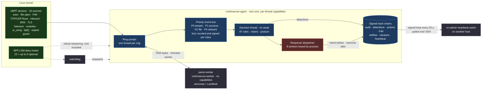

<div align="center">


# NorthNarrow

**Sovereign endpoint defence for Linux.**<br/>
Rust end to end · enforced in the kernel with eBPF and BPF-LSM · deterministic on the host · verified in a lab you can rerun.

[](https://github.com/northnarrow/northnarrow-new/actions/workflows/ci.yml)
[](https://github.com/northnarrow/northnarrow-new/actions/workflows/lab-vm.yml?query=event%3Aschedule)
[](https://github.com/northnarrow/northnarrow-new/releases)
[](LICENSE)
[](Cargo.toml)
[](docs/operator/KERNEL_COMPATIBILITY.md)

[Today](#what-it-does-today-and-what-it-does-not) ·
[Architecture](#architecture) ·
[Defence in depth](#defence-in-depth) ·
[Verified today](#verified-today) ·
[Limits](#limits-said-plainly) ·
[Quickstart](#quickstart) ·
[Report](#report-what-you-find) ·
[Roadmap](#roadmap) ·
[Supply chain](#security-and-supply-chain) ·
[Contact](#work-with-us)

</div>

> [!IMPORTANT]
> **Alpha: `v0.1.0-alpha`, 23 November 2026.** For testing on machines you can throw away, not
> yet for protecting real ones.
>
> - **Observe-only.** A fresh install runs the [`alpha` profile](docs/operator/ALPHA_PROFILE.md):
>   the agent detects, judges and records as it would in production, and does not act on a user
>   program: each verdict is recorded as what it *would have* done. Its self-protection and the
>   host-integrity refusals (untrusted kernel modules, kexec, foreign BPF programs) stay enforced.
> - **Linux x86_64 only**, verified in our lab on five kernels, which the nightly CI also runs:
>   5.15, 6.1, 6.8, 6.12 and 7.0 (Ubuntu 22.04, 24.04 and 26.04; Debian 12 and 13).
> - **Built with AI assistance, under the founder's direction.** A single-founder project from
>   the EU. The founder sets the direction, decides and reviews. The code, and much of the
>   design, were written with Claude Code (Anthropic's AI coding assistant). Reviews and
>   red-team rounds were run by separate AI agents, and the lab tests can be rerun by anyone.
> - **Self-assessed.** Nothing here has been validated by a third party. Every number below
>   points to the file or the CI run it comes from, and
>   [`KNOWN_LIMITATIONS.md`](docs/operator/KNOWN_LIMITATIONS.md) lists what does not work yet.

---

## What it does today, and what it does not

**Today, on each Linux host it runs on, NorthNarrow:**

- watches what runs, the files it touches and the connections it makes, through eBPF sensors
  in the kernel, and judges every event with deterministic rules, chain correlation and an
  adaptive posture, on the host;
- signs every record into hash chains you can verify offline (`nn-admin chain verify`), and
  writes a signed heartbeat every 30 s that a verifier on another host checks
  ([`HEARTBEAT.md`](docs/operator/HEARTBEAT.md));
- defends itself against root outside a signed maintenance window: BPF-LSM hooks refuse
  signals, ptrace, changes to its files, maps, links and cgroups, untrusted module loads, kexec
  and the foreign BPF programs that could blind it;
- keeps its evidence on the host: no telemetry to the vendor, no phone-home; an export to your
  own SIEM only when you sign an overlay for it ([`EXPORT.md`](docs/operator/EXPORT.md));
- installs, upgrades with rollback and uninstalls cleanly, from a tarball or a `.deb`
  (the `.rpm` is built and signed, but not yet tested in our lab), checked against the release's signed checksums and build provenance.

**What it does not do today:**

- act on user programs under the `alpha` profile: that is the alpha's design, and `enforcing`
  is a signed profile switch ([`ALPHA_PROFILE.md`](docs/operator/ALPHA_PROFILE.md));
- record forks, exits or credential changes as events (exec only), or DNS over TCP, DoT or DoH;
- prove its detection coverage: no adversarial campaign has run, and no third party has
  validated it;
- give a backend or a fleet console, or run on ARM64, Windows or macOS;
- prevent by default: the exec policy, the exec quarantine and copy on first write are
  experimental and off.

The full list, with what each item means for you and the workaround when there is one:
[`KNOWN_LIMITATIONS.md`](docs/operator/KNOWN_LIMITATIONS.md).

---

## Why NorthNarrow

For a European bank, hospital, utility or public body under NIS2 and DORA, where endpoint
telemetry goes and who decides on it are part of the risk. NorthNarrow keeps both on the host:

| | **NorthNarrow** |
|---|---|
| Where telemetry goes | **stays on the host**: the agent's only traffic of its own is a DNS probe to `127.0.0.1:53` — unless the operator signs an export overlay, which sends exactly the fields [`EXPORT.md`](docs/operator/EXPORT.md) lists to the operator's own SIEM |
| Who decides | **deterministic rules**, correlation and an adaptive posture, on the host; no AI model on the host |
| Who responds | **the host itself**, on a graduated ladder whose containment only a signed human command lifts; under the `alpha` profile a response against a user program is recorded, not carried out |
| Can root switch it off? | **hardened against root**: BPF-LSM refuses signals, ptrace, file tampering, cgroup kills, freezes, moves and resource limits, and BPF programs that could signal the agent, root included, outside a signed maintenance window, under every profile. Not absolute: see [the limits](#limits-said-plainly) |
| Air-gapped hosts | **first-class**: no update channel, offline attestation |
| Trust | **signed hash chains**, a signed heartbeat verified off the host, open code, a lab and a CI gate anyone can rerun |

---

## Architecture



| | |
|---|---|
| **Sense** | Sixteen sources on tracepoints, kprobes, uprobes, fentry/fexit and BPF-LSM hooks. Each source's attach point, fallbacks, failure mode, budgets, truncations and loss counters are a contract in code, and the agent signs a capability manifest of what really attached, at boot and at every change ([sensor contract](docs/operator/SENSOR_CONTRACT.md)). |
| **Prioritise** | Every event class has its own queue. Tamper (P0) is taken first, so a flood of file opens no longer pushes denials out. A full queue follows its class's policy, and every drop is counted and signed, never silent ([event bus](docs/architecture/EVENT_BUS.md)). |
| **Decide** | One OS thread with no `await` judges every event against the engine's 87 rules, chain correlation and the posture; most of the blocking I/O it used to do now runs elsewhere. There is no AI model on the host: the on-host LLM advisor was removed in Wave 4 ([upgrade notes](docs/operator/UPGRADE_NOTES_WAVE4.md)). |
| **Act** | Responses go to a dispatcher: eight workers by default, Critical first, one process's responses in order. Each action is a signed intent before it runs and a signed outcome after it. The posture rises from OBSERVING through ALERTED and ENGAGED to COMBAT only on corroborated evidence. COMBAT climbs from INVESTIGATE to NEUTRALIZE to ISOLATE, and only an Ed25519-signed command releases it. Under the `alpha` profile every step is recorded as what it would have done, and none is carried out. |
| **Isolate** | Hostile bytes (DNS names today) are parsed by an unprivileged worker: the `northnarrow-worker` account, no capabilities, a seccomp allowlist and Landlock. A source test checks that the root core calls no parser. Each core thread keeps only the capabilities its role needs. The keys live in one `KeyStore`, locked in memory and kept out of core dumps, and the signing key is decided once at boot ([process model](docs/architecture/PROCESS_MODEL.md)). |
| **Hold** | BPF-LSM deny hooks protect the agent, the watchdog and their files, maps, links and cgroups from root outside a signed trusted-installer window ([trust model](docs/design/ANTITAMPER_TRUST_MODEL.md)). A watchdog respawns the agent, and ten inert decoy files that look like kill switches trip a Critical rule when someone tampers with one. |
| **Prove** | Every admin operation, posture change, detection and action lands in a signed, hash-chained log with numbered rows and anchored heads (`nn-admin chain verify`). Every 30 s a signed heartbeat carries the loss counters, the chain heads and the manifest's hash to a verifier on another host ([heartbeat](docs/operator/HEARTBEAT.md)). |

<details>
<summary><b>The workspace: the crates of the Wave 4 restructure</b></summary>

| Crate | Holds |
|---|---|
| `nn-model` | the vocabulary: events, verdicts, actions and outcomes, process keys, posture kinds |
| `nn-proto` | the admin protocol, signed payloads, quorum, the core/worker IPC |
| `nn-evidence` | signed chains behind a `Signer` trait: canonical form, row numbers, heads, verification; no key |
| `nn-parse` | parsers of hostile bytes (DNS records and names, TLS ClientHello); fuzzed, run in the worker |
| `nn-core` | detection, posture, correlation, COMBAT and response policy, the sensor contract, the bus types; no OS call |
| `nn-linux` | the adapters: eBPF loader and sensors, `/proc`, actuators, self-defence, systemd, `KeyStore`, sandbox |
| `nn-admin` | the operator client |
| `northnarrow-agent` | the composition: typed boot phases, bus and pipeline, admin server, worker supervisor |

`nn-model`, `nn-proto`, `nn-evidence`, `nn-parse` and `nn-core` are pure: no OS interface, no
`unsafe`, and CI builds them for non-Linux targets. The allowed dependencies between crates are
in [`docs/architecture/module-map.toml`](docs/architecture/module-map.toml), and
`xtask/tests/workspace_layers.rs` enforces them.

</details>

---

## Defence in depth

What a root shell can try against the agent **outside a signed maintenance window**, what stops
it, and what it leaves behind. Inside a window (`nn-admin trusted-installer-grant`, an admin key
with the trusted-installer role) upgrades, uninstalls and restarts work as usual.

| Attack | Defence | Evidence left |
|---|---|---|
| `kill -9`, or any signal to the agent or the watchdog | `task_kill` refuses every userspace signal but signal 0, a self-signal and agent ↔ watchdog | signed denial, `NN-L-AT-001`, posture escalation |
| `ptrace`, `/proc/<agent>/mem` | `ptrace_access_check` refuses | signed denial, `NN-L-AT-001` |
| Delete, rename, rewrite or `chmod` the binaries, units, keys or chains; add a drop-in or an overlay | `inode_*`, `file_open` and `file_permission` deny hooks; no new entries in the agent's directories | signed `unlink`, `rename`, `setattr`, `write`, `create` |
| `systemctl kill -s SIGKILL` (`cgroup.kill`), `systemctl freeze`, a move out of the unit's cgroup | the units' cgroups protected; the move guard, self-tested at every boot | signed `cgroup_kill`, `cgroup_freeze`, `cgroup_move` |
| A low `memory.max` (an OOM kill), `cpu.max` or `pids.max` starvation, `systemctl set-property`, a cgroup v1 `freezer`, `oom_score_adj` | refused, except PID 1 writing back a file's registered value; cgroup v1 where systemd runs the unified hierarchy | signed `cgroup_limit`, `cgroup_v1`, `oom_adj`; PID 1's attempts as `RelayedTamperAttempt` |
| Confine the agent to fewer CPUs (a `cpuset` partition beside it, its cgroup's `cpuset.cpus`, a thread's affinity), which no hook is asked about | every 5 s the agent compares the CPUs it runs on with those it should; three rounds it cannot judge in a row are recorded too | signed `cpu_confined`, `NN-L-AT-001`; the `own_cpus` degradation in `nn-admin status` |
| Rewrite the agent's BPF maps, detach or replace its links | `bpf_map` and `bpf` hooks refuse write handles and link detach/update | signed `bpf_map` / `bpf_link` denial, `NN-L-BPF-002` |
| `kexec` into a kernel without the agent | the running agent refuses kexec image loads; `kernel.kexec_load_disabled=1` covers the time before it starts | signed denial, `NN-L-AT-001` |
| Freeze, starve or blind the agent some other way | the watchdog respawns it; the external verifier alerts | `SILENT`, `STOPPED`, `DEGRADED`, `REPLAY` or `TAMPERED` off the host |
| Load an untrusted kernel module (a file outside the running kernel's module tree, an `init_module` buffer, a module file changed since boot outside a package transaction) | **refused** by the module-load judge, unless a signed `module-allow` line names the module ([`RULE_POLICY.md`](docs/operator/RULE_POLICY.md)) | signed denial, `R018_KernelModuleLoad` |
| Load a foreign BPF program of a type that can kill, blind or replace the agent's hooks (tracing — bpftrace, BCC, another EDR's sensors —, `lsm`, `struct_ops`, `ext`, `raw_tracepoint_writable`) | **refused**, unless a signed per-loader opt-out names its loader (`install.sh --allow-bpf-tools`, `--allow-bpf-loader PATH`); a program that calls `bpf_send_signal`, `bpf_probe_write_user` or `bpf_override_return`, or an `fmod_ret` program, is refused whoever loads it ([`ALPHA_PROFILE.md` §1.2](docs/operator/ALPHA_PROFILE.md#12-bpftrace-bcc-and-other-tracing-tools)) | signed `bpf_prog_type` denial, `NN-L-AT-001`; an opted-out load `bpf_prog_opt_out` (Low) |
| A BPF program of any type, network types included, calling a signalling kfunc (`bpf_send_signal_task` from 6.13, the task-work signal kfuncs from 6.18) | refused at the load to every foreign loader, opt-outs included | signed `bpf_prog_type` denial naming the kfunc |
| Inside a window, load a program refused outside one (a signal, override or write helper), to use it once the window closes | the load is held and always signed: with no room for its record it is refused. Outside a window its runs, attaches and tail-call slots are refused and signed (a rare use can pass without a record of its own), and it is signed again while it stays loaded | signed `bpf_held_load`, `bpf_held_use` |
| `prlimit` (`RLIMIT_CPU`), scheduler, nice or I/O-priority starvation | `task_setrlimit`, `task_setscheduler`, `task_setnice` and `task_setioprio` refuse it | signed `rlimit`, `sched`, `nice`, `ioprio` |

The records that are the only trace of something let through (a held BPF load, a program the
agent never saw, kernel taint, the agent confined) spend no record budget, so a flood of refusals
cannot crowd them out; past 32 of a kind in a round, the most dangerous are named first and the
rest in the next rounds.

The test lab replays these attacks: `deploy/lab/nn-lab.sh tamper-check` runs each case with its
expected outcome and the evidence it must leave in the signed logs.

### Beside other BPF tools (bpftrace, BCC, Falco, Tetragon)

Because a foreign tracing program can kill the agent with a signal no hook sees, the agent
refuses foreign loads of nine BPF program types outside a window: the tracing ones (`kprobe`,
`tracepoint`, `perf_event`, `raw_tracepoint`, `tracing`), `raw_tracepoint_writable`,
`struct_ops`, `ext` and `lsm`. So by default bpftrace, BCC's tools, Falco's eBPF probes and
Tetragon's sensors do not start beside it. To run one, name its loader at install time:
`--allow-bpf-tools` names this host's bpftrace and the Python interpreter BCC's tools run under,
and `--allow-bpf-loader PATH` names any executable. The tracing types are then let through for
that executable, and every such load is recorded (`bpf_prog_opt_out`, Low). Whoever loads it,
the agent still refuses an `fmod_ret` program and a program that calls `bpf_send_signal`,
`bpf_send_signal_thread`, `bpf_probe_write_user` or `bpf_override_return`, so a tool's kill or
override actions (bpftrace's `signal()`, Tetragon's `Sigkill` and `Override`) are refused. The
flags never open `lsm`, `struct_ops` or `ext`, and `install.sh` signs no hand-made line that
does. Network program types (XDP, tc, `cgroup_skb`, socket filters) are not refused, unless
they call a signalling kfunc. bpftrace and BCC's `opensnoop-bpfcc` with the opt-out were
measured in our lab; Falco and Tetragon have not been tried there. Details:
[`ALPHA_PROFILE.md` §1.2](docs/operator/ALPHA_PROFILE.md#12-bpftrace-bcc-and-other-tracing-tools).

---

## Verified today

Measured on the code now on `main`, in our own lab and on GitHub-hosted KVM runners. These are our
own measurements, not a third party's. The figures counted from the code (rules, ATT&CK mapping,
deny hooks, eBPF programs, test functions, golden cases, fuzz targets, Kani proofs) are checked
against it on every `cargo test` by
[`xtask/tests/readme_figures.rs`](xtask/tests/readme_figures.rs).

| Area | Today | Source |
|---|---|---|
| Rules | **95** rules the agent can record: 87 in the engine, 8 issued outside it (anti-tamper, exploit guard, exec policy and its environment checks, exec quarantine). Strongest test per rule: an end-to-end test or a lab script for 35, unit tests only for 55, no proof yet for 5 (the experimental exec-policy and quarantine records) | [`RULE_CATALOGUE.md`](docs/detection/RULE_CATALOGUE.md) |
| ATT&CK mapping | 95 of 95 rules mapped to 66 techniques and sub-techniques under 12 of 15 Enterprise tactics (ATT&CK 20.0, pinned). This is a mapping, not a coverage claim: **0 rules have campaign proof** | [`ATTACK_COVERAGE.md`](docs/detection/ATTACK_COVERAGE.md) |
| Kernel enforcement | **22** BPF-LSM deny hooks on every supported kernel, plus up to 6 optional deny programs (the two ACL hooks, `file_ioctl_compat`, the cgroup move guard's three): 28 on 6.8, 6.12 and 7.0, 26 on 5.15 and 6.1 (the ACL hooks start in 6.2). The eBPF object holds **124** programs; on the five lab kernels (5.15, 6.1, 6.8, 6.12, 7.0) the verifier rejected none of the 124 of the latest pre-alpha release candidate (November 2026), the mount guard's six included, and the nightly fails any above 900,000 processed instructions | [`CAPABILITY_PROGRAM.md`](docs/roadmap/CAPABILITY_PROGRAM.md), C23 |
| Host tests | more than **6,300** test functions in the workspace (`#[test]` and `#[tokio::test]`). `cargo test --workspace` runs the unprivileged ones on every pull request; the privileged ones (feature `test-privileged`, or `#[ignore]`) run as root in the KVM guests below | [`ci.yml`](.github/workflows/ci.yml) |
| Privileged suites | run as root in 5 KVM guests every night; every run is public on the workflow's page. Scheduled runs on `main` from 7 to 22 Nov 2026: 7 of 16 green | [`lab-vm.yml`](.github/workflows/lab-vm.yml) |
| Anti-tamper lab | 104 adversarial cases, 100 as expected on Ubuntu 24.04. The other four are named: two known gaps (an unsigned module without lockdown, a vacuum of the agent's journal), one recorded deviation and one case not run | [`anti-tamper.sh`](deploy/lab/adversarial/anti-tamper.sh) |
| Event bus | in the lab's file-open flood (EXP-13), anti-tamper denials lost: 3,699 before the priority bus, **0** after | [`EVENT_BUS.md`](docs/architecture/EVENT_BUS.md) |
| Response | 400 kill trees at once: the longest queue wait went from 19 s to **1.6 s** | [`EVENT_BUS.md`](docs/architecture/EVENT_BUS.md) §2e |
| Heartbeat | the off-host verifier flagged a stopped agent in 6.5 s, a replayed export in 5.0 s, a frozen agent in 55.7 s and a cut network in 66.7 s | [`HEARTBEAT.md`](docs/operator/HEARTBEAT.md) |
| Determinism | **35** golden replay cases of the decision path and **15** of the posture and COMBAT ladder, checked byte for byte on every `cargo test`; **15** fuzz targets; **4** Kani proofs, run every week and on the pull requests that touch them | [`GOLDEN_REPLAY.md`](docs/validation/GOLDEN_REPLAY.md) |
| Resources | lab, QEMU guests (Ubuntu 24.04 and Debian 13, kernels 6.8 and 6.12, 2 and 4 vCPU): the agent's RSS about 65–95 MiB (up to 113 MiB after an exec storm), the watchdog's about 5 MiB, a worker's about 5.5 MiB; about 3 % of one core at rest, 14–25 % under exec-heavy work (a kernel build, container starts); an event recorded in about 0.5 ms (p50) and 3–5 ms (p99) | [`KNOWN_LIMITATIONS.md`](docs/operator/KNOWN_LIMITATIONS.md#performance) |
| Cost | lab, QEMU guests (a guest is noisier than a real host). Per operation, rc11 on QEMU under Windows (WHPX), Ubuntu 24.04, kernel 6.8, 2 vCPU, three complete runs (A/A at most 7 %), **lower bounds** (the reference with the agent off still ran three of its LSM programs): an `open` + `read` + `close` about **+2.1–2.2 µs** (+55…+64 %), a `fork` + `exec` + `wait` about **+0.08 ms** (+9…+16 %). On real work: a kernel build 4 to 17 % slower with the agent on; package installs, container runs, `fio` and `pgbench` within the lab's noise (about 5–25 %). The older committed baseline (Ubuntu 24.04, a lab build): `git status` +24 % from the cgroup move guard | [`PERF_BASELINE.md`](docs/validation/PERF_BASELINE.md) |
| Long runs | lab soaks: 48 hours on release candidate rc5, then confirmation soaks of 4 and 12 hours up to rc11, with no regression of stability | [`KNOWN_LIMITATIONS.md`](docs/operator/KNOWN_LIMITATIONS.md#performance) |
| Benign hosts | records a plain host's own work made, now Low or gone, the attack beside each judged as before: a container runtime's start (runc's sealed copy of itself, containerd's module probes, a cgroup controller enabled), a package's system account and initramfs build, a kernel or DKMS package's modules, cloud-init's boot, sudo-rs, `go test`, npm in its own directories, logrotate and rsyslog, and a desktop AppImage (judged by the image file the user ran, not by its mount under `/tmp`; what the program then does is judged as for any other). `sudo ./deploy/uninstall.sh`: 0 High in 15 runs | [`UPGRADE_NOTES_WAVE4.md`](docs/operator/UPGRADE_NOTES_WAVE4.md) §34–§49 |
| Detection fixes | a hard link of a watched setuid binary into a user-writable directory (NN-L-FIM-002); a write anywhere below a kernel's module directory (NN-L-FIM-008); the cross-process chains through descendants that only forked (NN-L-CHAIN-004/005/006/008); a reverse shell known by the shell's file, not its name (R020); an administrator's session vouched for only by the host's own sudo or su, run by a user who is not root, for what it ran as root after authenticating | [`CHANGELOG.md`](CHANGELOG.md) |
| Lifecycle | fresh install, in-place upgrade with rollback, clean uninstall (`upgrade-check`, `uninstall-check`); `.deb` / `.rpm` by `pkg-check`. `install.sh` refuses a host it cannot run on before any change (among them a host whose `/etc/ld.so.preload` loads a library into every program); after `uninstall.sh --purge` only what the guide lists remains (a state diff on five distributions); the uninstall exits 3 when the removal ends at the next boot, 4 when it left processes the agent had contained thawed and listed; a release verifies with its signed `SHA256SUMS` where no `gh` attestation is available | [operator guide](docs/operator/INSTALL_UPGRADE_UNINSTALL.md) |

### Kernels

One binary for every kernel: struct offsets come from the live BTF at boot and tracepoint
layouts from tracefs. `northnarrow-agent --btf-check <btf>` gives an offline verdict for any
kernel, and a weekly CI job recomputes the matrix over BTFHub.

| Distribution | Kernel | systemd | Status | Nightly gate | Deny hooks |
|---|---|---|---|---|---|
| Ubuntu 22.04 LTS | 5.15 | 249 | supported, degraded (DNS names through the `ITER_IOVEC` path only) | every night and on PRs | 26 |
| Debian 12 | 6.1 | 252 | supported | every night | 26 |
| Ubuntu 24.04 LTS | 6.8 | 255 | supported | every night and on PRs | 28 |
| Debian 13 | 6.12 | 257 | verified in the lab | every night | 28 |
| Ubuntu 26.04 LTS | 7.0 | 259 | verified in the lab | every night | 28 |
| AlmaLinux 9 | 5.14 (el9) | — | supported with SELinux enforcing; **not re-verified since Wave 4** | self-hosted lab only | not measured since |

The full matrix, with its prerequisites, is in
[`KERNEL_COMPATIBILITY.md`](docs/operator/KERNEL_COMPATIBILITY.md). Without the `bpf` LSM in the
active list the agent refuses to start, unless an operator opts into degraded mode (trust level
L0, no enforcement).

### Capability levels

Thirty capabilities, each with a level that changes only together with its evidence:
**0** absent, **1** partial, **2** present and tested in the lab, **3** mature and verified on every
supported kernel. The table in
[`CAPABILITY_PROGRAM.md`](docs/roadmap/CAPABILITY_PROGRAM.md) was re-assessed on 2026-11-03
against `main`, separately from the lab PRs, and C14 and C23 again on 2026-11-11. It is a
self-assessment, not a third party's.
**No capability is at level 3.** Eleven are at 2, ten at 1 and nine at 0.

<details>
<summary><b>All thirty levels</b></summary>

| Level | Capabilities |
|---|---|
| **2** | C01 Linux sensor · C06 file telemetry and FIM · C07 endpoint network telemetry · C12 synchronous inline blocking (experimental, off by default) · C14 behavioural detection and correlation · C16 structured ATT&CK mapping · C17 response on processes and files · C23 anti-tamper and self-defence (*provisional*) · C24 offline and air-gapped operation · C25 data sovereignty · C26 open code and inspectability |
| **1** | C05 process telemetry (exec only) · C11 containers · C13 malware prevention · C15 custom rules · C18 host network isolation · C19 rollback · C20 automation · C21 SIEM export (signed OCSF records to files and syslog over TLS) · C27 product supply chain · C28 safe content release |
| **0** | C02 Windows · C03 macOS · C04 ARM64 · C08 identity / ITDR · C09 cloud · C10 NDR · C22 backend · C29 independent public validation · C30 generative AI on the host (absent by design) |

</details>

<details>
<summary><b>External security audit and internal review</b></summary>

An external audit of commit `16f7563` reported 444 findings (6 Critical, 70 High, 159 Medium,
188 Low, 21 Informational). Every Critical, High and Medium finding is closed. Of the 209 Low and
Informational findings, 189 are fixed, 6 are obsolete and 10 are declined with a stated reason;
4 are still open (3 of them partly fixed), among them the adversarial campaign run. Each fix
starts from a regression test that fails without it. The status of each finding is in
[`docs/audit/EXTERNAL_AUDIT_16f7563.md`](docs/audit/EXTERNAL_AUDIT_16f7563.md), and what the
fixes change for an operator is in
[`docs/operator/UPGRADE_NOTES_AUDIT_16f7563.md`](docs/operator/UPGRADE_NOTES_AUDIT_16f7563.md).
The internal review log [`docs/audit/NN_REVIEW_2026-10-08.md`](docs/audit/NN_REVIEW_2026-10-08.md)
has 87 entries: every High is closed, and 4 Medium and 1 Low are open.

</details>

---

## Limits, said plainly

**Hardened against root, not root-proof.** The deny hooks refuse root outside a signed window,
but a defence inside the kernel is only as strong as the kernel's integrity:

- **Residuals of the self-protection** are measured in the
  [trust model](docs/design/ANTITAMPER_TRUST_MODEL.md) and listed for testers in
  [`KNOWN_LIMITATIONS.md`](docs/operator/KNOWN_LIMITATIONS.md). Among them: a refused `set-property` stays in
  systemd's own copy until a `daemon-reload`, a soft-reboot leaves the units `failed`, and a
  stop propagated by a `Conflicts=` unit records the unit as stopped.
- **A trusted-installer window is the host's, not the installer's.** While it is open, every
  root process gets what it lifts, and a BPF program attached inside it keeps running after it
  (its load is signed): open one only on a host you trust for its length, and keep it short.
- **The kernel is the host's to protect.** A root that can write kernel memory, load an unsigned
  module or `kexec` a kernel can defeat any in-kernel defence. Kernel lockdown (`integrity`),
  module signing, Secure Boot and `kexec_load_disabled` are recommended, and
  `nn-admin host-check` reports each one
  ([`INSTALL_UPGRADE_UNINSTALL.md` §3.1](docs/operator/INSTALL_UPGRADE_UNINSTALL.md#31-host-hardening-checks-nn-admin-host-check)).
  While it runs, the agent refuses kexec loads and untrusted module loads itself (outside a
  trusted-installer window); a module loaded inside a window is let through and recorded, and
  one loaded before the agent started is beyond its reach.
- **A root holding the agent's key can forge its heartbeat and rewrite its history.** The deny
  hooks keep the key from readers, and a signature proves which key wrote a row, not that the
  host is honest. The signing is not forward-secure yet: a stolen key signs a rewritten past as
  well as new rows; only what already left the host (the beats an off-host verifier fetched, an
  export) is beyond its reach. Hardware attestation (a TPM quote of the measured boot) is future work
  ([`HEARTBEAT.md`](docs/operator/HEARTBEAT.md#what-it-does-not-prove)).
- **The capability manifest is the agent's own word.** Every round, the sensor self-test sees
  a harmless live event of 13 of the 16 sources and checks that the other 3 are still attached
  (no harmless operation makes them report); the boot's deny self-test exercises `task_kill` and
  the move guard ([`SENSOR_CONTRACT.md`](docs/operator/SENSOR_CONTRACT.md) §5a).

**Not verified yet.**

- **No adversarial campaign proof.** The V2 campaign has not run, so no rule has campaign
  evidence, and no coverage percentage is published until it has
  ([`docs/validation/matrix.md`](docs/validation/matrix.md)).
- **No independent validation.** The public CI runs are a step towards it, not a substitute (C29).
- **A minimal export, no backend.** Evidence stays on the host unless the operator signs an
  export overlay: then the detections and the responses (and only the other chains the overlay
  names) go as signed OCSF records to the operator's own files or syslog receiver; the heartbeat
  leaves by pull (C21, C22; [`docs/operator/EXPORT.md`](docs/operator/EXPORT.md)).
- **Linux x86_64 only.** No ARM64, no Windows, no macOS (C02 to C04).
- **Partial telemetry.** Exec events only: forks reach the lineage through a kernel record, not
  as events, and there are no exit or credential events (C05). DNS is read
  over UDP only: no DNS over TCP, DoT or DoH, and no `recvmmsg` (C07).
- **A TLS fingerprint is not an identity.** NN-L-NET-003 records a JA3 or JA4 in the operator's
  list as Medium and never acts on it; `enforce` is refused until it has a second predicate.
- **Narrow measurements.** The cost of one `exec` or `open` of this release is measured on one
  QEMU guest only (Ubuntu 24.04, kernel 6.8, 2 vCPU), as lower bounds. Its resources and its
  cost on real work were measured on QEMU guests only (Ubuntu 24.04 and Debian 13), and the
  long-run soaks ran in the same lab.
- **The alpha does not block user programs.** Under a fresh install's `alpha` profile, a
  verdict against a user program is recorded as `would have: <action>`, not carried out; the
  self-protection and the host-integrity refusals (modules, kexec, foreign BPF) stay enforced.
  `enforcing` is a signed profile switch ([`ALPHA_PROFILE.md`](docs/operator/ALPHA_PROFILE.md)).
- **Prevention is experimental and off by default:** the exec policy, exec quarantine and copy on
  first write ([`EXEC_POLICY.md`](docs/design/EXEC_POLICY.md)).

---

## Quickstart

**Testing the alpha? Start with the
[alpha tester guide](docs/operator/ALPHA_TESTER_GUIDE.md).** It takes about an hour on a
throwaway virtual machine and assumes no knowledge of the project: install and verify the
release, make it record a few harmless things, read what it recorded, collect diagnostics
without personal data, report, and uninstall.

Requirements: Linux x86_64, a kernel with BTF (`/sys/kernel/btf/vmlinux`), the `bpf` LSM added
to the kernel's running list rather than a fixed list
([Enabling the `bpf` LSM](docs/operator/KERNEL_COMPATIBILITY.md#enabling-the-bpf-lsm-kernel-command-line)),
bpffs at `/sys/fs/bpf`, systemd, and `nft`.

**From the release.** `<ver>` below is `0.1.0-alpha`, and the packages are
`northnarrow_0.1.0-alpha-1_amd64.deb` and `northnarrow-0.1.0-alpha-1.x86_64.rpm` (versioned
`0.1.0~alpha-1` inside: dpkg's and rpm's form of a pre-release). Without `gh` 2.49 or newer, the
guide's [§4](docs/operator/ALPHA_TESTER_GUIDE.md#4-install-and-verify) verifies the release with its
signed `SHA256SUMS.asc` and `gpgv` instead. With `gh`, a release is verified and installed like this:

```sh
# 1. Download the release tarball + checksums from the Releases page, then verify
#    (the attestation must come from the release workflow at a v* tag)
sha256sum -c SHA256SUMS
gh attestation verify northnarrow-<ver>-x86_64-linux.tar.gz --repo northnarrow/northnarrow-new \
  --cert-identity-regex '^https://github\.com/northnarrow/northnarrow-new/\.github/workflows/release\.yml@refs/tags/v' \
  --deny-self-hosted-runners

# 2. Install: starts both units and enables them at boot (--no-enable leaves them stopped), and
#    bootstraps an admin key at /root/northnarrow-admin.key that you must move off-host.
#    install.sh checks the tree's MANIFEST.sha256, the tarball against SHA256SUMS (both found
#    in ..) and the attestation (gh, or cosign with --attestation).
tar xzf northnarrow-<ver>-x86_64-linux.tar.gz && cd northnarrow-<ver>-x86_64-linux
sudo ./deploy/install.sh

# 3. Look around
sudo nn-admin status
sudo nn-admin detections --key <offline-admin.key> --limit 20   # signed read (telemetry-read role)
sudo nn-admin audit verify                                      # the signed audit log's hash chain
sudo nn-admin host-check                                        # the host's own hardening

# Later (both need a key with the trusted-installer role)
sudo ./deploy/install.sh --upgrade --grant-key <admin.key>     # in place, keys and chains preserved
sudo ./deploy/uninstall.sh [--purge] --grant-key <admin.key>   # the only order the anti-tamper layer allows
```

**From source.** In a checkout, `cargo xtask build --release` compiles the eBPF object with a pinned
nightly toolchain and embeds it in the agent, stamped with its source hash and its own SHA-256.
Then:

```sh
sudo ./deploy/install.sh --source-tree     # bootstraps an admin key at /root/northnarrow-admin.key: move it off-host
```

`install.sh` starts both units and enables them at boot (`--no-enable` leaves them stopped; then
`sudo systemctl enable --now northnarrow-agent northnarrow-watchdog` when you are ready).

<details>
<summary><b>What the installer checks, and where to read next</b></summary>

The installer never downgrades its checks by itself. A release tree installs only when the tree
matches the tarball and the SLSA provenance attestation of its tarball verifies (with `gh`, or an
offline bundle) or, on a host with no attestation verifier, the tarball matches a `SHA256SUMS`
whose `SHA256SUMS.asc` is a good signature by the release key (`gpgv`). A tree without `MANIFEST.sha256` is refused unless `--source-tree` is given,
and anything less needs `--allow-unverified` (lab and development only). Each flag is logged,
recorded in `/etc/northnarrow/install-manifest.json` and reported by `nn-admin host-check`.

An upgrade is a transaction: the files it replaces are backed up, the new units must pass a
health check, and any failure restores and restarts the previous version
(`docs/operator/INSTALL_UPGRADE_UNINSTALL.md` §2). At every boot the agent compares its
binaries and its eBPF object with the manifest, and refuses to start on a mismatch.

- Upgrading from `v0.0.1-tappa9.0`: read
  [`UPGRADE_NOTES_AUDIT_16f7563.md`](docs/operator/UPGRADE_NOTES_AUDIT_16f7563.md), then
  [`UPGRADE_NOTES_WAVE4.md`](docs/operator/UPGRADE_NOTES_WAVE4.md).
- Stopping and restarting the agent:
  [`INSTALL_UPGRADE_UNINSTALL.md` §3.7](docs/operator/INSTALL_UPGRADE_UNINSTALL.md#37-stopping-and-restarting-the-agent).
- Watching a host from another one: [`HEARTBEAT.md`](docs/operator/HEARTBEAT.md).
- Operator guides: [`docs/operator/`](docs/operator/) (install, COMBAT recovery, FIM trust
  model, container hosts, honeypots, rule policy, workers, boot integrity, evidence chains).
- Lab and test runbook: [`docs/integration-test-runbook.md`](docs/integration-test-runbook.md).

</details>

---

## Report what you find

- **A bug, a false positive or a detection gap:** open an issue with its template
  ([new issue](https://github.com/northnarrow/northnarrow-new/issues/new/choose)): *Bug report*,
  *False positive* or *Detection gap*. Read
  [`KNOWN_LIMITATIONS.md`](docs/operator/KNOWN_LIMITATIONS.md) first: some limits are known. The
  guide's [§8](docs/operator/ALPHA_TESTER_GUIDE.md#8-collect-diagnostics-without-personal-data)
  collects diagnostics without personal data, and
  [§9](docs/operator/ALPHA_TESTER_GUIDE.md#9-report-what-you-found) says what a report needs.
  Never attach the admin key, a file from `/etc/northnarrow` or a real credential.
- **A vulnerability** — a way to stop, blind or get around the agent's self-protection, or to
  make it sign something false: report it privately, as [`SECURITY.md`](SECURITY.md) says
  (Security → Report a vulnerability), never in a public issue.

---

## Roadmap

The tracker is [`CAPABILITY_PROGRAM.md`](docs/roadmap/CAPABILITY_PROGRAM.md): one note per
lab PR, with what moved, what the lab measured and what is still open. The history of the
earlier stages is in [`ROADMAP.md`](ROADMAP.md), the goals are in [`VISION.md`](VISION.md), and
the long-term technical vision is in [`VISION_TECHNICAL.md`](VISION_TECHNICAL.md). No dates are
published: milestones ship in order.

**Done: the foundations.** eBPF sensors, the rule engine, the response engine, the adaptive
posture, anti-tamper, the signed COMBAT release, FIM, deception, network observability and
detection at scale and depth. Remediation of 440 of the external audit's 444 findings. The
on-host LLM advisor removed, which also took about 150 crates out of `Cargo.lock`.

**Done: Phase 2, the restructure (R00 to R14).**

- [x] The layered crates: `nn-model`, `nn-proto`, `nn-evidence`, `nn-parse`, `nn-core`, `nn-linux`, `nn-admin`
- [x] A priority event bus (P0 to P3) with per-class loss counters and signed drop rows
- [x] A decision thread with no `await`; ring pumps on threads of their own
- [x] A response dispatcher with a worker pool keyed by process, and a signed intent and outcome for every action
- [x] A signed heartbeat with an external verifier on another host (`nn-admin heartbeat watch`)
- [x] The sensor contract and the signed capability manifest
- [x] Privilege separation: unprivileged workers in Landlock and seccomp, parsers out of the root process, one `KeyStore`, capabilities per thread
- [x] Key continuity: the signing key decided once at boot

**Phase 3, first part done: the first alpha.** `v0.1.0-alpha` (23 November 2026) came after phased checks
of release candidates rc1 to rc15 in our own lab: install, upgrade and uninstall on five
distributions, self-protection, detection, false-positive soaks of up to 48 hours, a final
review, and a run of the tester guide by a fresh AI agent that had only the guide and this README. These are our own checks, not an
independent validation.

- [x] The observe-only `alpha` profile for testers, with the self-protection enforced
- [x] The first tag release, with its build provenance and a signed `SHA256SUMS` that `install.sh` checks with or without `gh`
- [x] The pre-release soaks, false positives first: a benign host's daily records judged by identity, the attack beside each judged as before
- [x] Network telemetry (inbound connections, DNS answers, TLS fingerprints) and "no DNS, no connect": a connection to an address no DNS answer gave (the rule records, its kill refused until measured wider)
- [x] Foreign BPF loads and rootkit helpers refused (with a signed per-loader opt-out for tracing tools); the signalling kfuncs refused in every program type; a window's forbidden load held and signed
- [x] A self-test of every sensor, every round, each miss signed
- [x] Per-rule exemptions by cgroup or unit that hold only for processes started there: a process moved into an exempt cgroup loses the exemption, and the move is signed
- [x] Kernel lockdown checked by `nn-admin host-check`, and its switch refused outside a window
- [x] The agent's own CPUs watched: a confinement is signed
- [x] `prlimit` / `RLIMIT_CPU`, scheduler, nice and I/O-priority starvation refused outside a window
- [x] A minimal signed export of detections in OCSF (off by default, `docs/operator/EXPORT.md`)

**Next: the rest of Phase 3.**

- [ ] Process telemetry: fork, exit and credential changes
- [ ] Deception that trips when a decoy is used
- [ ] `isolate --ttl`: a signed isolation outside the COMBAT ladder, with an expiry
- [ ] A free, public self-assessment against MITRE's open emulation plans
- [ ] **Waves 2 and 3**: the remaining Linux capabilities, in the program's order (telemetry, prevention, detection, integration)

**Phase 4.**

- [ ] Export and backend: off-host chain anchoring, SIEM integration, fleet correlation
- [ ] ARM64
- [ ] More distributions
- [ ] Windows, then macOS

---

## Security and supply chain

- **Vulnerability disclosure:** [`SECURITY.md`](SECURITY.md). Please do not file
  security-sensitive reports as public issues.
- **No telemetry to the vendor, no phone-home, no update channel the agent reaches out to.**
  Updates are an operator action with a signed artefact. The one way evidence leaves the host is
  the signed export, which is off by default: only an overlay the operator signs turns it on, and
  then it sends only the chains that overlay names, to the operator's own files and receiver
  ([`docs/operator/EXPORT.md`](docs/operator/EXPORT.md)).

<details>
<summary><b>Release pipeline, packages, CI and dependencies</b></summary>

- **Signed releases.** A `v*` tag builds with a locked lockfile and pinned toolchains. It
  publishes the tarball, the `.deb` and `.rpm` packages, three CycloneDX SBOMs, `SHA256SUMS` and
  a SLSA build-provenance attestation bound to the exact commit and workflow. The attestation
  checks in `install.sh`, the operator guide and this README require the release workflow at a
  `v*` tag (`--cert-identity-regex '…release\.yml@refs/tags/v'`, `--deny-self-hosted-runners`),
  so the artefacts of a run on a branch do not verify as a release. Building and signing are
  separate jobs, and the job that compiles the dependency tree cannot request the signing token.
  `v0.1.0-alpha` is the first tag released this way.
- **Packages.** The `.rpm` is signed on tag builds, in its own job. Check it with `rpm -K` or
  dnf's `localpkg_gpgcheck` against
  [`deploy/release/RPM-GPG-KEY-northnarrow.asc`](deploy/release/RPM-GPG-KEY-northnarrow.asc),
  fingerprint `BBBB EB6F 5566 A1CE 99AE  8379 C66A E018 C172 7C8D` (RSA 4096, signing only,
  expires 2028-10-16). dpkg and apt do not verify a single package file, so check the `.deb`
  against its tag-bound attestation before `dpkg -i`
  ([operator guide §6.1](docs/operator/INSTALL_UPGRADE_UNINSTALL.md#61-verify-a-package-before-installing-it)).
- **Pinned CI.** Every GitHub action is pinned by commit SHA, and every tool installed with
  `cargo install` is pinned by version with `--locked`; a test fails on a tag-pinned action or
  an unpinned install. Every CI and release build is `--locked`, with the Rust release pinned in
  `rust-toolchain.toml`. The `rust-version` in `Cargo.toml` (1.98) is checked by a CI job that
  builds with it. Builds target `x86-64-v2`. Workflow tokens are read-only except where the
  release publishes, and no checkout leaves the token in `.git/config`.
- **Dependencies** are audited in CI (`cargo audit` on every lockfile, the fuzz harness and the
  eBPF crate included) on every change and daily, and Dependabot keeps them current. A CI step
  fails when the C libraries `onig_sys` or `zstd-sys` enter the agent's dependency graph.

</details>

---

## Tech stack

| Layer | Technology |
|---|---|
| Language | Rust, end to end: userland, CLI, watchdog and the eBPF programs ([aya](https://aya-rs.dev)) |
| Kernel side | eBPF tracepoints, kprobes, uprobes, fentry/fexit and BPF-LSM hooks; pinned maps and links survive agent restarts |
| Detection | deterministic: compiled rules, chain correlation, an adaptive posture and the COMBAT ladder; no model on the host |
| Cryptography | Ed25519 (admin keys, the agent's signing key), SHA-256 hash chains |
| Runtime | dedicated OS threads for the ring pumps, the decision and the responses; Tokio for the rest; `tracing` logs in a capped journald namespace |
| Deployment | four binaries (`northnarrow-agent`, `northnarrow-watchdog`, `nn-admin`, the quarantine scanner `northnarrow-scan`), hardened systemd units |

---

## Compliance and sovereignty

How the architecture answers each regulation. These are design properties, not certifications:
no conformity assessment has been made.

| Regulation | How the architecture answers it |
|---|---|
| **NIS2** | on-host detection and response; a structured, signed audit log for incident reporting |
| **GDPR** | no telemetry leaves the controller's perimeter; no processor relationship to declare; the export, off by default, sends to the controller's own receiver only the fields its signed overlay names ([`EXPORT.md`](docs/operator/EXPORT.md) §1a) |
| **DORA** | fully operational with degraded or absent connectivity; no vendor dependency for continued protection |
| **CRA** | a signed release pipeline, SBOMs, provenance attestation, a disclosure process |
| **EU AI Act** | no AI system on the host: detection and response are deterministic rules, correlation and posture (the on-host LLM advisor was removed in Wave 4). A future AI assistant would sit off the enforcement path, on a backend |

---

## Work with us

Open an issue with the title given below.

**Design partners.** NorthNarrow is looking for design partners: regulated EU institutions
(banking, insurance, healthcare, public administration, energy, telecommunications), critical
infrastructure operators with sovereignty constraints, Linux-heavy production environments
interested in on-host response, and security research labs who want to test the agent's defences.
You get early access, deep technical briefings, direct input on detection coverage and response
semantics, and acknowledgment at GA. We ask for real workload exposure, structured detection
feedback and co-authored incident retrospectives. *Issue title: "Design partner inquiry".*

**Investors.** Pre-revenue, at the first alpha, building toward first paid deployments in
regulated EU markets. Three bets: EU sovereignty as a hard procurement requirement; on-host,
deterministic detection with no trade-off on where telemetry goes; and active defence, a
containment that only a signed human command lifts.
*Issue title: "Investor inquiry", for diligence materials.*

**Engineers.** Not hiring yet: the project is single-founder by design during the alpha. If you
work on systems Rust, eBPF or kernel security and want to be on the early list, open an issue
with a short note. *Issue title: "General inquiry".* Contributions: [`CONTRIBUTING.md`](CONTRIBUTING.md).

**Press and media.** Give your publication, deadline and angle; we answer time-sensitive
requests within the working day. *Issue title: "Press / media inquiry".*

---

## License

[Apache License 2.0](LICENSE). Third-party attributions are in [`NOTICES.md`](NOTICES.md).

## Disclaimer

Alpha software under active development, observe-only by default. The detection rules are mapped to ATT&CK and
most are tested, but none has campaign proof yet, and no detection system covers every
unknown threat. Pair NorthNarrow with defence in depth, and read [Kernels](#kernels) before
you deploy on a kernel we have not tested.

---

<div align="center">

**Built in Rust. Enforced in the kernel. Engineered for sovereignty.**

Made in Italy 🇮🇹 · Built for Europe 🇪🇺

</div>
