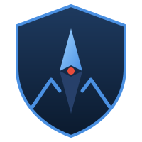
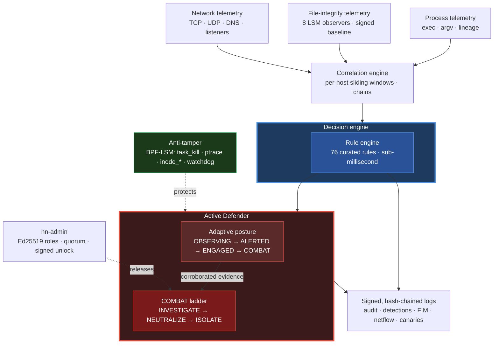

<div align="center">



# NorthNarrow

**Sovereign XDR for Linux — written in Rust, enforced in the kernel, deterministic on the host, verified in a lab you can rerun.**

[](https://github.com/northnarrow/northnarrow-new/actions/workflows/ci.yml)
[](https://github.com/northnarrow/northnarrow-new/releases)
[](LICENSE)
[]()
[]()
[]()
[]()
[]()

*Deterministic rules decide in microseconds; correlation and an adaptive posture carry the evidence from one event to the next.<br/>
The host hardens, engages and isolates on its own — and nobody can switch it off, root included.*

[Why NorthNarrow](#why-northnarrow) ·
[How it works](#how-it-works) ·
[What is verified today](#what-is-verified-today) ·
[Quickstart](#quickstart) ·
[Supply chain](#security-and-supply-chain) ·
[Roadmap](#roadmap) ·
[Design partners](#for-design-partners)

</div>

---

## Why NorthNarrow

Most endpoint security products are a sensor that streams your telemetry to someone
else's cloud, where a model you cannot inspect decides, and an operator you do not
employ reacts hours later. For a European bank, hospital, utility or public body under
NIS2, DORA and the AI Act, that architecture is a liability before it is a product.

NorthNarrow inverts it:

| | Cloud-first EDR/XDR | **NorthNarrow** |
|---|---|---|
| Where telemetry goes | vendor cloud | **stays on the host** — no outbound path exists in the code |
| Who decides | remote models + SOC | **the agent's deterministic rules**, correlation and posture, in microseconds — no model on the host's enforcement path |
| Who responds | a human, later | **the host itself**, with a graduated ladder and a signed human override |
| Can root disable it? | usually | **no** — BPF-LSM denies signals, ptrace and file tampering, root included |
| Works air-gapped? | degraded | **first-class** |
| Trust model | "trust us" | **signed audit chain, signed release, SBOM, provenance attestation, rerunnable lab** |

---

## How it works



**Sense.** eBPF programs (tracepoints, kprobes, fexit and BPF-LSM hooks) watch
process execution with argv and parent lineage, file integrity against a signed baseline,
and every TCP/UDP flow, DNS query and listener — kernel-side, with no userland polling.
TLS fingerprints (JA3/JA4) have a parser but no sensor yet, so the JA3 rule is inactive
and `nn-admin net status --key` says so. The DNS rules read plain DNS on UDP/53: flows to DNS
over TLS (TCP/853) and QUIC (UDP/443) are counted, not read, a systemd-resolved on DNS
over TLS is listed as a blind spot, and DNS over HTTPS looks like any HTTPS.

**Decide.** A rule engine with 76 curated rules across process, file, network and
deception families gives a deterministic verdict in microseconds; chain rules correlate
events of one process tree over time, and every response comes from a rule or from the
COMBAT ladder. Detection on the host is deterministic by design: the on-host language
model that used to review execs no rule matched was removed in Wave 4 (a multi-GB model
inside the root agent, fed with strings an attacker writes, was the largest attack
surface of the agent; its accuracy was never measured; it cost gigabytes of RAM). Any AI
assistant belongs off the enforcement path, on a future backend for analysts.

**Act.** An adaptive posture machine moves the host from OBSERVING to COMBAT only on
corroborated evidence (signals from one login session, service or container never vouch
for another). In COMBAT a graduated ladder investigates, neutralises the attributed
process tree while sparing host-critical processes, and isolates the network as a last
resort. Release
requires an Ed25519-signed command; keys carry roles and can be quorum-gated.

**Hold.** BPF-LSM hooks deny every userspace signal to the agent and watchdog, deny
ptrace, deny writes, renames and unlinks on the agent's binaries, units, keys and chain
logs, and deny new entries in the agent's own directories — for root too, outside a
signed trusted-installer window. A watchdog respawns the agent through its own systemd
unit. Ten inert honeypot files on the control surface trip a rule if anyone looks for a
kill switch.

**Prove.** Every admin operation, posture transition and detection lands in a signed,
hash-chained log whose rows are numbered and whose heads are anchored, so a cut or
emptied chain is reported too; `nn-admin chain verify` checks every chain. A detection
records the response as it happened (`KillProcess (already gone)`, `suppressed
(detect-only)`). Nothing is sent anywhere.

---

## What is verified today

Pre-Beta, single-founder project, built in the EU. The claims above are backed by a
test lab anyone with KVM can rerun (`deploy/lab/nn-lab.sh`), not by a slide:

| | |
|---|---|
| Rule engine | 76 rules (plus the anti-tamper denial rule NN-L-AT-001), 18 process rules exercised end-to-end against real processes in the lab |
| Kernel side | 16 BPF-LSM deny hooks, plus the optional ones the kernel has (the two ACL hooks from 6.2, `file_ioctl_compat` from 6.8 and its stable backports: 19 on 6.8), attached, pinned and checked across restarts (`privileged_map_pin`), next to the tracepoint, kprobe, fexit and LSM sensors |
| Anti-tamper | `nn-lab.sh tamper-check`: adversarial cases (signals, ptrace, protected files and pins, BPF maps and links, mounts, io_uring, unit drop-ins, `systemctl`), each with its expected outcome and the evidence it must leave in the signed logs |
| Tests | about 2,100 host tests in CI, plus privileged e2e suites (agent, watchdog, detection, canary, network, map pinning, honeypots, anti-tamper enforce mode, response targets) on the lab guests — 35 suites, 0 failed, on Ubuntu 24.04, Ubuntu 22.04 and Debian 12 at the last gate |
| Lifecycle | fresh install, in-place upgrade and clean uninstall exercised on every nightly (`upgrade-check`, `uninstall-check`); the `.deb`/`.rpm` lifecycle by `pkg-check` |
| Resilience | `kill -9` from root denied by the kernel; agent respawned by the watchdog in its own unit |
| Kernels | **Ubuntu 24.04 / 6.8, Debian 12 / 6.1, AlmaLinux 9 / 5.14 — supported; Ubuntu 22.04 / 5.15 — supported (degraded: no DNS QNAME).** One binary: kernel struct offsets are resolved from the live BTF at boot, tracepoint layouts from tracefs; `northnarrow-agent --btf-check <btf>` gives an offline verdict for any kernel, and a weekly CI job recomputes the matrix over BTFHub — see `docs/operator/KERNEL_COMPATIBILITY.md`. Kernels from 6.9: the `inode_setattr` hook gained an argument there, whose position the agent reads from the running kernel since lab PR 164; verified on Debian 13 (6.12) on 2026-10-16: chmod, chown and touch of a protected file refused, the FIM observer records the change; privileged suites 81 of 82 (the one failure, DNS attribution, fails on `main` too: the guest resolves through systemd-resolved) |
| Known issues | tracked in the open: the external audit tracker [`docs/audit/EXTERNAL_AUDIT_16f7563.md`](docs/audit/EXTERNAL_AUDIT_16f7563.md) (with its follow-ups found in the lab) and [`docs/audit/NN_REVIEW_2026-10-08.md`](docs/audit/NN_REVIEW_2026-10-08.md) (27 entries, all High/Medium closed) |

### External security audit

An external audit of commit `16f7563` (2026-10-12) reported 444 findings (6 Critical,
70 High, 159 Medium, 188 Low, 21 Informational). Waves 0 and 1 (every Critical and High
finding) and Wave 2 (the Medium findings) are closed. Each fix starts from a regression
test that fails without it; most lots also have a before-and-after run in the lab, and
every lot passed the privileged suites on two or three lab kernels. Wave 3 (Low and
Informational) has not started. Status per finding, the
method and the follow-ups the fixes turned up are in
[`docs/audit/EXTERNAL_AUDIT_16f7563.md`](docs/audit/EXTERNAL_AUDIT_16f7563.md); what the
fixes change for an operator, regressions included, is in
[`docs/operator/UPGRADE_NOTES_AUDIT_16f7563.md`](docs/operator/UPGRADE_NOTES_AUDIT_16f7563.md).

What is **not** verified yet, said plainly: the adversarial campaign on the Kali range
(Tappa 10.7: its denominator is frozen in `docs/validation/`, no rule has campaign proof
yet, and two Critical rules cannot fire in this build), soak runs longer than 24 h,
the agent's overhead on guests other than Ubuntu 24.04 (the one committed
baseline: [`docs/validation/PERF_BASELINE.md`](docs/validation/PERF_BASELINE.md)),
and kernels from 6.9. They are on
[`ROADMAP.md`](ROADMAP.md) (Tappe 10.7 and 10.8) and in the tracker's follow-ups.

---

## Quickstart

Requirements: Linux x86_64, a kernel with BTF (`/sys/kernel/btf/vmlinux`) and the `bpf`
LSM enabled (`bpf` added to the kernel's `lsm=` list, never a fixed list — see
[Enabling the `bpf` LSM](docs/operator/KERNEL_COMPATIBILITY.md#enabling-the-bpf-lsm-kernel-command-line)),
bpffs at `/sys/fs/bpf`, systemd.

```sh
# 1. Download the release tarball + checksums from the Releases page, then verify
#    (the attestation must come from the release workflow at a v* tag)
sha256sum -c SHA256SUMS
gh attestation verify northnarrow-<ver>-x86_64-linux.tar.gz --repo northnarrow/northnarrow-new \
  --cert-identity-regex '^https://github\.com/northnarrow/northnarrow-new/\.github/workflows/release\.yml@refs/tags/v' \
  --deny-self-hosted-runners

# 2. Install (does NOT start anything; bootstraps an admin key at /root/northnarrow-admin.key
#    that you must move off-host). install.sh checks the tree's MANIFEST.sha256, the tarball
#    against SHA256SUMS (both found in ..) and the attestation (gh, or cosign with --attestation).
tar xzf northnarrow-<ver>-x86_64-linux.tar.gz && cd northnarrow-<ver>-x86_64-linux
sudo ./deploy/install.sh
sudo systemctl enable --now northnarrow-agent northnarrow-watchdog

# 3. Look around
sudo nn-admin status
sudo nn-admin detections --key <offline-admin.key> --limit 20   # signed read (telemetry-read role)
sudo nn-admin audit verify                                      # walks the signed hash chain

# Later (both need a key with the trusted-installer role)
sudo ./deploy/install.sh --upgrade --grant-key <admin.key>     # in place, keys and chains preserved
sudo ./deploy/uninstall.sh [--purge] --grant-key <admin.key>   # the only order the anti-tamper layer allows
```

The installer does not step its checks down on its own: a release tree installs only when
its tarball's SLSA provenance attestation verifies (`gh`, or an offline bundle) and the tree
is the tarball's; a tree without `MANIFEST.sha256` is refused unless `--source-tree` is
given; anything less needs `--allow-unverified` (lab and development). Each flag is logged
(`auth.warning`), recorded in `/etc/northnarrow/install-manifest.json` and reported by
`nn-admin host-check`. An upgrade is a transaction: the files it replaces are backed up,
the new units must pass a health check, and any failure restores the previous version and
starts it again (`docs/operator/INSTALL_UPGRADE_UNINSTALL.md` §2). At every boot the agent compares its binaries and its eBPF object
with that manifest and refuses to start on a mismatch, or when the manifest was removed
after a verified boot. Upgrading from `v0.0.1-tappa9.0`: read
[`docs/operator/UPGRADE_NOTES_AUDIT_16f7563.md`](docs/operator/UPGRADE_NOTES_AUDIT_16f7563.md)
first, then
[`docs/operator/UPGRADE_NOTES_WAVE4.md`](docs/operator/UPGRADE_NOTES_WAVE4.md) (the
on-host LLM advisor removed: its flags are ignored with a WARN).

Building from source: `cargo xtask build --release` (compiles the eBPF object with a
pinned nightly toolchain and embeds it, stamped with its source hash and its own
SHA-256, into the agent), then `sudo ./deploy/install.sh --source-tree`. Operator
guides: [`docs/operator/`](docs/operator/) — install/upgrade/uninstall, COMBAT recovery,
FIM trust model, container hosts, honeypots. Lab and test runbook:
[`docs/integration-test-runbook.md`](docs/integration-test-runbook.md).

---

## Security and supply chain

- **Signed releases.** Every `v*` tag builds with a locked lockfile and pinned
  toolchains and publishes the tarball, the `.deb` and `.rpm` packages, two CycloneDX
  SBOMs, `SHA256SUMS` and a SLSA build-provenance attestation bound to the exact commit
  and workflow. The attestation checks in `install.sh`, the operator guide and this
  README require the release workflow at a `v*` tag (`--cert-identity-regex
  '…release\.yml@refs/tags/v'`, `--deny-self-hosted-runners`): the artefacts of a run on
  a branch do not verify as a release. Building and signing are separate jobs; the job
  that compiles the dependency tree cannot request the signing token.
- **Packages.** The `.rpm` is signed on tag builds, in its own job, and checked with
  `rpm -K` or dnf's `localpkg_gpgcheck` against
  [`deploy/release/RPM-GPG-KEY-northnarrow.asc`](deploy/release/RPM-GPG-KEY-northnarrow.asc),
  fingerprint `BBBB EB6F 5566 A1CE 99AE  8379 C66A E018 C172 7C8D` (RSA 4096, signing only, expires 2028-10-16). The `.deb` is checked with its tag-bound attestation
  before `dpkg -i`, since dpkg and apt do not verify a single package file
  ([operator guide §6.1](docs/operator/INSTALL_UPGRADE_UNINSTALL.md#61-verify-a-package-before-installing-it)).
- **Pinned CI.** Every GitHub action is pinned by commit SHA, every tool installed with
  `cargo install` by version with `--locked`; a test fails on a tag-pinned action or an
  unpinned install. Builds target `x86-64-v2` unless a developer opts into `native`.
  Every CI and release build is `--locked` (a manifest change without its lockfile
  fails), with the Rust release pinned in `rust-toolchain.toml` (Dependabot proposes
  the next); `rust-version` in `Cargo.toml` (1.89) is checked by a CI job that builds
  with it. Workflow tokens are read-only except where the release publishes, and no
  checkout leaves the token in `.git/config`.
- **Dependencies** are audited in CI (`cargo audit`, every lockfile, the fuzz harness and
  the eBPF crate included) on every change and daily, and kept current by Dependabot. A
  CI step fails when the C libraries `onig_sys` or `zstd-sys` enter the agent's
  dependency graph. Removing the on-host LLM advisor (Wave 4) took about 150 crates out
  of `Cargo.lock`, the vendored `candle-core` among them.
- **Vulnerability disclosure:** [`SECURITY.md`](SECURITY.md). Please do not file
  security-sensitive reports as public issues.
- **No telemetry, no phone-home, no update channel the agent reaches out to.** Updates
  are an operator action with a signed artefact.

---

## Tech stack

| Layer | Technology |
|---|---|
| Language | Rust, end to end — userland, CLI, watchdog and the eBPF programs ([aya](https://aya-rs.dev)) |
| Kernel side | eBPF tracepoints, kprobes, fexit and BPF-LSM hooks; pinned maps and links survive agent restarts |
| Detection | deterministic: compiled rules, chain correlation, an adaptive posture and the COMBAT ladder; no model on the host |
| Cryptography | Ed25519 (admin keys, agent signing key), SHA-256 hash chains |
| Runtime | Tokio; structured `tracing` logs in a capped journald namespace |
| Deployment | three static binaries (`northnarrow-agent`, `northnarrow-watchdog`, `nn-admin`), two hardened systemd units |

---

## Roadmap

The operating roadmap is [`ROADMAP.md`](ROADMAP.md) (Italian; fixed order, one Tappa at a
time), the long-term technical vision is [`VISION_TECHNICAL.md`](VISION_TECHNICAL.md).
Where we stand:

- **Closed:** eBPF sensors, rule engine, response engine, adaptive posture,
  anti-tamper, signed COMBAT release, FIM, deception, network observability, detection
  at scale and depth. (The on-host LLM advisor and its RAG knowledge base, built in
  Tappa 6, were removed in Wave 4: on-host detection stays deterministic.)
- **In progress:** adversarial validation on a Kali range; reliability — multi-kernel
  support, soak testing, fuzzing, packaging; the external audit's follow-ups and its
  Wave 3 (Low and Informational findings).
- **Next:** local UI, proactive hardening scout, Windows agent, sovereign EU backend and
  fleet console, private beta.

No calendar dates are published; milestones ship in milestone order.

---

## Compliance and sovereignty

| Regulation | How the architecture answers it |
|---|---|
| **NIS2** | on-host detection and response, structured signed audit log for incident reporting |
| **GDPR** | no telemetry leaves the controller's perimeter; no processor relationship to declare |
| **DORA** | fully operational under degraded or absent connectivity; no vendor dependency for continued protection |
| **CRA** | signed artefacts, SBOM, provenance attestation, disclosure process |
| **EU AI Act** | no AI system on the host: detection and response are deterministic rules, correlation and posture (the on-host LLM advisor was removed in Wave 4). A future AI assistant would sit off the enforcement path, on the backend |

---

## For design partners

NorthNarrow is **actively seeking design partners**: regulated EU institutions (banking,
insurance, healthcare, public administration, energy, telecommunications), critical
infrastructure operators with sovereignty constraints, Linux-heavy production
environments interested in autonomous defence, and security research labs who want to
attack the pipeline.

You get early access, deep technical briefings, direct input on detection coverage and
response semantics, and acknowledgment at GA. We ask for real workload exposure,
structured detection feedback and co-authored incident retrospectives.

**To engage:** open a *design-partner inquiry* issue (template under *New Issue*).

## For investors

Pre-revenue, pre-Beta, building toward first paid deployments in regulated EU markets.
Three asymmetric bets: EU sovereignty as a hard procurement requirement; on-host,
deterministic detection removing the cloud-telemetry trade-off that is the incumbents'
moat; active defence as the next category after fifteen years of alert generation. Open an *investor
inquiry* issue for diligence materials.

## For engineers

Not hiring yet — single-founder by design during Pre-Beta. If you work on systems Rust,
eBPF or kernel security and want to be on the early list, open a
*general inquiry* issue with a short note.

## For press and media

Open a *press / media inquiry* issue with publication, deadline and angle; we answer
time-sensitive requests within the working day.

---

## License

[Apache License 2.0](LICENSE). Third-party attributions in [`NOTICES.md`](NOTICES.md).

## Disclaimer

Pre-Beta software under active development. Detection rules are validated against
published threat intelligence and a reproducible lab, but no detection system covers
every unknown threat. Pair with defence-in-depth, and read the verified-matrix section
before deploying on a kernel we have not tested.

---

<div align="center">

**Built in Rust. Enforced in the kernel. Engineered for sovereignty.**

Made in Italy 🇮🇹 · Built for Europe 🇪🇺

</div>
